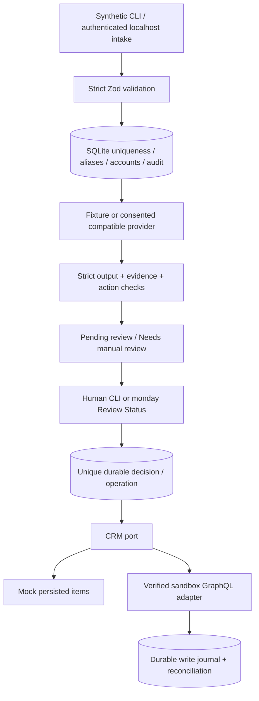

# Architecture and operating boundaries

Trust boundaries: external text and model output have no tool authority. Zod rejects unknown keys and unsafe enums; evidence must be short literal substrings. A heuristic input flag increases manual review; it cannot guarantee model security. The provider has no execution tools. Approval checks persisted review state and a validated action; monday writes additionally check configured workspace, exact demo names, board allowlist, mapped IDs/types/labels and item membership. No provider chooses column IDs, URLs, code or real employees.

Local records have UUIDs, UTC timestamps and schemaVersion=1 JSON. Leads have unique external ID and normalised email. Aliases preserve duplicate external-ID replay. Known domains relate Accounts; unknown domains deliberately create separate accounts. Plan B stores contact fields on Lead. Plan A can create Contact items; native account/contact/lead/opportunity relations require UI target configuration and rediscovery. Local leadId/accountId relations work without that entitlement. Opportunities are stored only after an approved propose_opportunity action; fixture recommendations use internal follow-up instead.

SQLite tables: leads, aliases, accounts, operations, opportunities, audit, writes and mock_items. Parameterised statements and BEGIN IMMEDIATE protect local creation. A unique operation per lead and immutable decision key survive restarts. Within-process approval deliveries are serialised. One local process is the operating assumption; distributed execution and changing a decision after completion are deliberately excluded.

Live adapter: fetch to monday v2 with variables and pinned 2026-07 header; bounded cursor pagination. Reads retry at most three attempts with exponential backoff/jitter and retry hints (hints above ten seconds stop for operator retry). GraphQL errors on HTTP 200 fail. Error messages expose safe codes, never upstream bodies or tokens. Fixed column writes include suggestion/review/execution values; stage is only set on initial creation.

Follow-up representation: a plain internal update on the original Lead, with `CRM_DEMO_OPERATION:<decisionId>` marker; no mention, email, external message or automatic owner assignment. It is an internal work instruction, not a monday task subitem. An explicitly approved opportunity action instead creates a Proposed item in Opportunities. Its unique Operation ID supports reconciliation; no value/revenue is invented.

Before creates, a durable journal records intent. After a lost response, read and find the unique marker; if found, complete locally. If absent, retain uncertainty and refuse to reissue even after restart. The operator must investigate, not clear the journal blindly. Updates of fixed column values are naturally repeatable but still verified before each write. Pending/failed state is preserved locally and exposed in status/metrics; an HTTP 201 is local intake acceptance, not proof of live sync.

Trade-offs: no production auth/SSO, webhook, public endpoint, queues, RAG, custom frontend or distributed locking. Local API key plus loopback binding fits a demonstration. No real LLM quality, monday compatibility or relation entitlement can be proven by the mock suite. SQLite stores synthetic messages locally; audits and routine logs omit them. Restrict local file access and keep `.local` out of version control.
