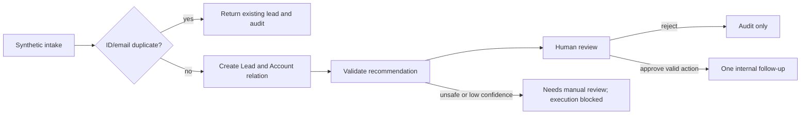

# Current and future process

| Step | Fictional current process | Demonstrated future process |
|---|---|---|
| Capture | Copy shared-inbox enquiry | Validate authenticated API/CLI input |
| Identify | Search manually | Unique external ID and normalised exact email |
| Relate | Guess company name | Link account by validated domain; unknown domains stay separate |
| Qualify | Read and summarise manually | Structured recommendation with source evidence |
| Route | Pick colleague | Suggest fictitious team; owner stays unassigned |
| Review | Informal decision | Explicit immutable Approved/Rejected decision |
| Act | Create follow-up manually | One internal follow-up after approval; no outreach |
| Monitor | Ad hoc spreadsheet | Computed metrics, durable audit and retry queue |

Humans retain authority over qualification stages, actual owner assignment, customer commitments, all communications and corrections to ambiguous inputs. Approval authorises the displayed allowlisted proposal only. An invalid/low-confidence recommendation cannot become executable merely by changing a status; resolve the source and obtain a valid proposal first. The demo has no autonomous contact overwrite, deal advancement or outbound channel.
