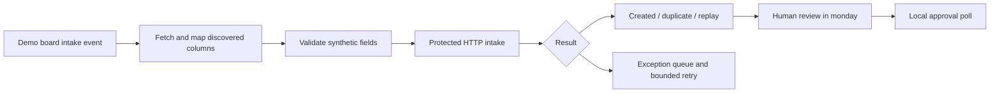

# Make scenario — manual, unverified

No Make account was connected and no scenario was executed. No native workflow or AI agent is configured. The offline demo does not simulate a successful Make run. Account authentication, plan entitlement and a secure route to the local API remain manual prerequisites. Do not start a trial, buy credits or expose a public tunnel as part of this project.

1. In your existing monday account, confirm the subscription and native integration entitlement. Free-plan native automation/integration is unavailable; use CLI/polling in that case. Check actual workspace and app permissions rather than inferring them from API access.
2. In your existing Make account, create a disabled scenario. Add the official **monday.com v2** app and authenticate its monday.com connection using your own token through Make's connection UI. Never paste it into this repository. The official [Make documentation](https://apps.make.com/monday?v=1) says v1 maintenance has ended; module names/availability must be confirmed in your account.
3. Choose the board-item change/new-item trigger (the current app documents **Watch Board's Items**). Restrict to the allowlisted `CRM Demo | Leads` board. Watch only intake fields; filter out app-written AI, review and execution changes to prevent loops. For production-like event delivery, use a dedicated intake-ready flag manually set once; this demo does not configure that flag automatically.
4. Add the monday item-details module (**Get an Item** where exposed by v2); select the triggering item ID. Map the actual discovered column IDs, not column titles. Require a non-empty External ID, synthetic example.com email, name, company, source and message. Add a dedicated `Enquiry Message` long-text column manually if using board-created leads; the application intentionally does not store full messages in monday's AI Summary column.
5. Add HTTP **Make a request**: POST to the administrator's already-authorised protected endpoint `/api/leads/intake`. JSON body: `{ "externalId": "mapped-external-id", "fullName": "Demo Person", "workEmail": "demo@example.com", "companyName": "Synthetic Company", "source": "manual", "message": "Please share demo pricing." }`. Map fields with Make's JSON builder (no string concatenation). Set `Content-Type: application/json` and `X-Demo-Api-Key` from Make's secure configuration. Do not map or automatically send approval decisions.
6. The local server binds to 127.0.0.1 and is deliberately unreachable from Make's cloud. A user-managed secure HTTPS relay or existing authorised reachable host is required for this step; neither is provisioned. Never remove authentication to work around connectivity. Until a route is supplied, label the scenario **unverified / blocked** and demonstrate the same payload locally using the CLI or API tests.
7. Branch on responses: 201=created; 200=replayed/duplicate (stop further creation); 400=validation exception queue; 401=connection/key issue; 413=oversized payload; 5xx/network=bounded retry using the **same externalId**, then manual exception queue. A successful HTTP response with `lead.syncStatus=Pending sync` is a sync exception, not successful monday completion. Do not retry with a new identifier.
8. Run once with a synthetic lead, replay it, and inspect module bundles plus local audit and real demo board. Capture real screenshots with timestamp, exact board ID and returned lead ID; redact credentials. Require one logical Lead and no automatic follow-up. Keep the scenario off until the operator has reviewed evidence and confirmed entitlement/costs. No successful run is claimed here.

Optional native workflow, only if already entitled: in the demo board's Automate UI choose a status-change rule; when Review Status becomes Needs manual review, set a separate internal Review Flag to Attention. Select the demo board and existing flag labels explicitly. Use an internal flag instead of notifications/outreach. Test with one synthetic item, record the run, then turn it off. The flag is informational and cannot approve an action. AI agents are optional and account-specific; no native AI feature is required.

Public webhooks are omitted. If later added, follow the official [challenge handshake](https://developer.monday.com/api-reference/reference/webhooks), validate a trusted shared-secret ingress, deduplicate events and prevent write-trigger loops. A challenge response alone does not authenticate events.
